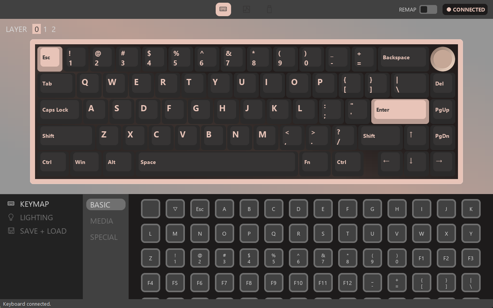

# SK65 Studio

A VIA-style configurator for the **Womier SK65 V1**, a keyboard that has no VIA support. Remap keys on every layer, set up the knob and control the lighting from one window, and store your keymap in the keyboard itself.



This is an unofficial community project. It is not affiliated with or endorsed by Womier, Weikav or the VIA team.

## Install

1. Open the [latest release](../../releases/latest).
2. Download `Womier_SK65_Studio_Setup.exe` and run it.
3. Click through the installer. You only do this once.

Needs 64-bit Windows 10 or 11.

After that, open **Womier SK65 Studio** from the Start menu, by searching for it, or from the desktop shortcut. To remove it, use **Settings > Apps > Installed apps** or Programs and Features in Control Panel. Your settings stay in `%APPDATA%\SK65 Studio`, so they survive updates and reinstalling.

The installer is not code signed, so Windows may show a SmartScreen warning. Choose **More info**, then **Run anyway**. Some antivirus tools may flag the app because it uses a keyboard hook. Each release lists a SHA-256 hash, and you can build it yourself from this source.

## Which keyboards work

| Keyboard | Works |
|---|---|
| Womier SK65 V1 (reports as USB `0603:0351`, "lucky65") | Yes |
| Womier SK65 V2 | No. It supports VIA, so use [VIA](https://usevia.app) |

The USB ID is shared by other boards in this family, such as the Weikav Lucky65 V1, but they have only been read about, not tested. Key layouts differ, so saving a keymap to them is at your own risk.

## Features

- **Keymap:** edit the base, Fn and Fn2 layers, and save them into the keyboard's memory.
- **Knob:** assign rotate left, rotate right and press, including mouse wheel actions.
- **Lighting:** effect, colour, brightness and speed apply as soon as you change them.
- **Key tester:** check every key and the knob.
- **Connection check:** a live status light and a self-test of each interface.
- **Profiles:** save and load layouts as JSON files.
- **System tray:** turn on **Minimize To System Tray** on the Settings page, and the minimize button hides the app in the tray. Click the tray icon to bring it back, or right-click it to exit.

## Good to know

- **Saving replaces the whole keymap**, on all three layers, including anything set earlier in Womier's software.
- **The keyboard can't be read back.** The app remembers what it last saved, but it can't see changes made elsewhere.
- **The knob's rotation has no known firmware setting.** Its actions run in software, so keep **REMAP** on and the app open.
- **Some actions can't be stored in the keyboard:** Mute, Calculator, Search and mouse wheel.
- **Fn itself is handled by the firmware**, so Windows never sees it.
- **Only one copy runs at a time.** Opening the app again brings back the running copy, even from the tray.
- **Keys dark?** Press Fn+Space. It switches RGB off in the keyboard, and the app can't turn it back on.
- **Something went wrong?** Hold Fn+Esc for 3 seconds to factory reset the keyboard.

## Privacy and permissions

The app asks for administrator rights because of how it is packaged (`--uac-admin`), and so its software remap also works in other elevated windows.

It uses a Windows keyboard hook only while REMAP is on or the Key Tester or Connection page is open. Key presses are used on your computer and never stored or sent anywhere. The app makes no network connections. Everything it does is in [`sk65_studio.py`](sk65_studio.py).

## Build from source

Needs Python 3.14 on Windows.

```bash
python -m venv .venv
.venv\Scripts\pip install -r requirements.txt
.venv\Scripts\python sk65_studio.py
```

Run the tests, which never touch a real keyboard:

```bash
.venv\Scripts\python test_layers.py
.venv\Scripts\python test_lighting.py
.venv\Scripts\python test_tray.py
```

Build the exe, then compile [`installer.iss`](installer.iss) with Inno Setup:

```bash
.venv\Scripts\pyinstaller --noconfirm --onefile --windowed --uac-admin --icon "assets\via.ico" --add-data "assets\via.ico;assets" --hidden-import pystray._win32 --name "Womier_SK65_Studio" sk65_studio.py
```

Pushing a `v*` tag builds both files with GitHub Actions and publishes a release.

## Protocol

[PROTOCOL.md](PROTOCOL.md) documents the keyboard's USB protocol, including what has and hasn't been confirmed on real hardware. It was worked out by reading Womier's software for interoperability. None of that software is included here.

## Credits

- [VIA](https://github.com/the-via/app): the visual design, theme colours and app icon come from VIA, licensed under GPL-3.0.
- [hjs-weikav-keymap-patch](https://github.com/tiger42/hjs-weikav-keymap-patch): notes on the firmware and its software family.
- [Lucky65 software and mapping guide](https://b4zookaw.notion.site/Weikav-Lucky65-software-and-mapping-f7757a4a5485486b9a36b4afe8a9d19d) by B4zookaw.

## License

[GPL-3.0](LICENSE). Provided without warranty; you use it with your keyboard at your own risk.
