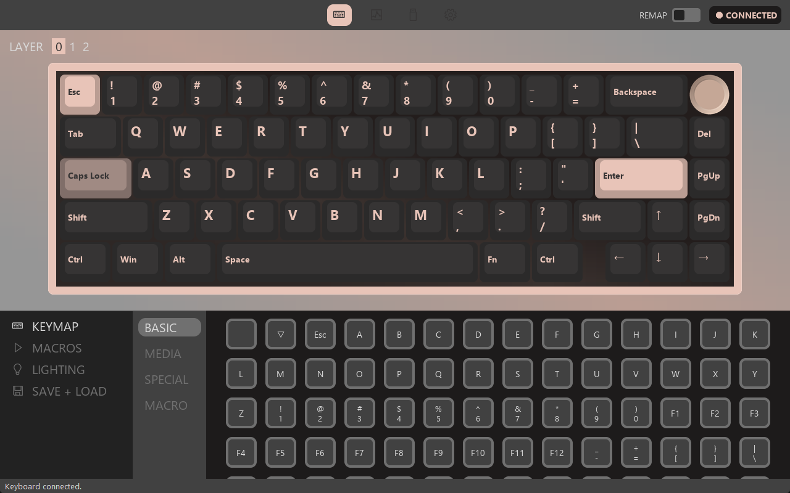
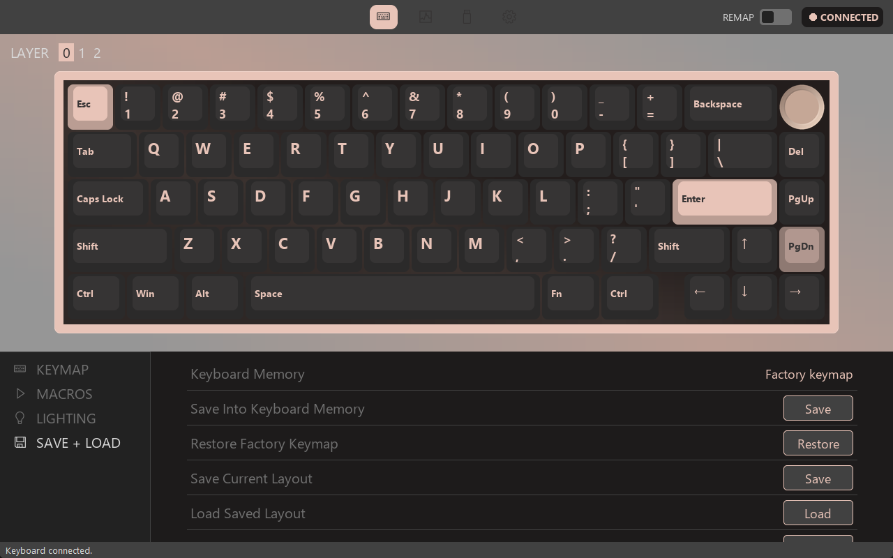
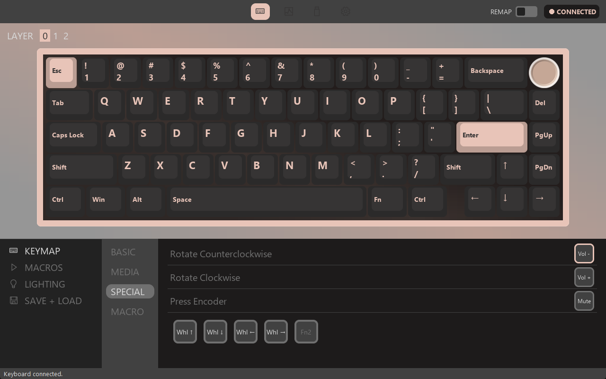
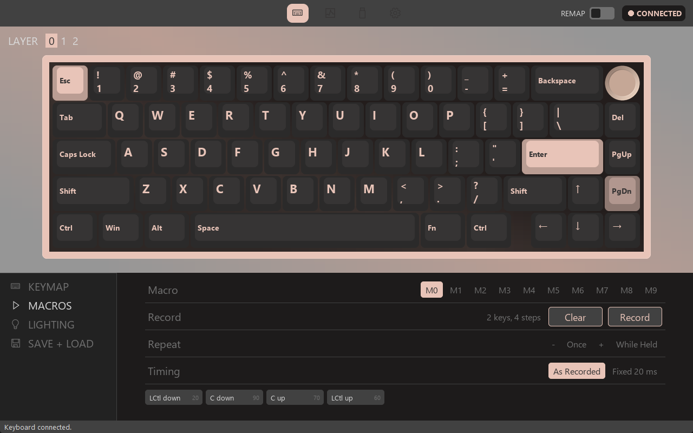
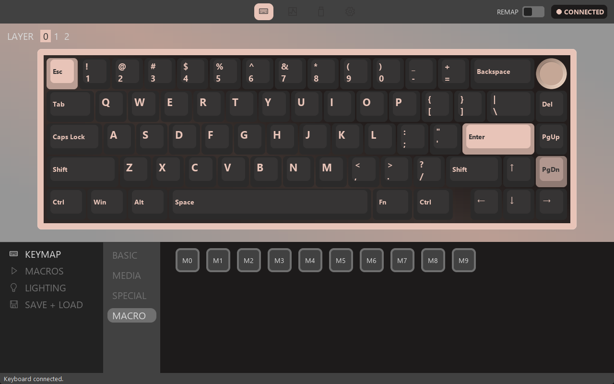
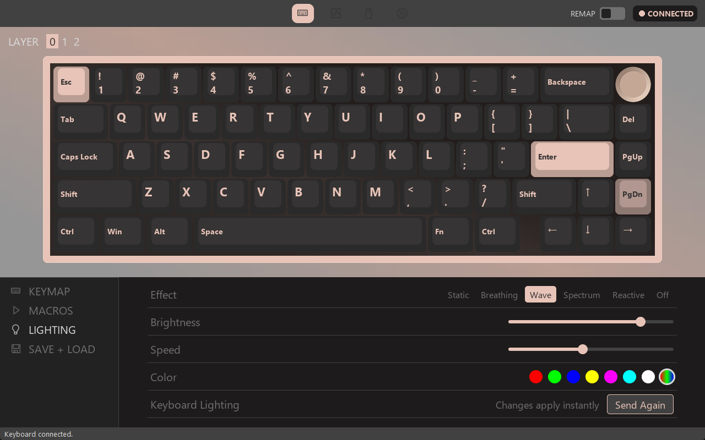
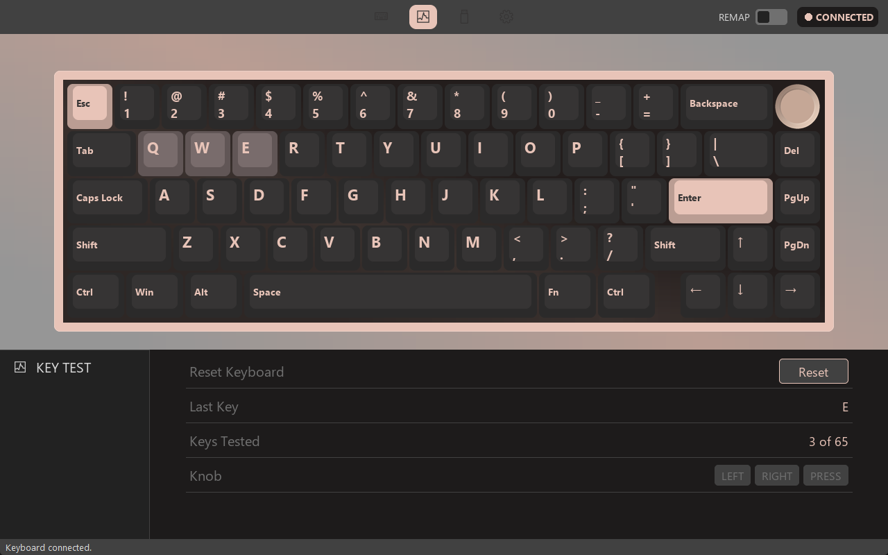
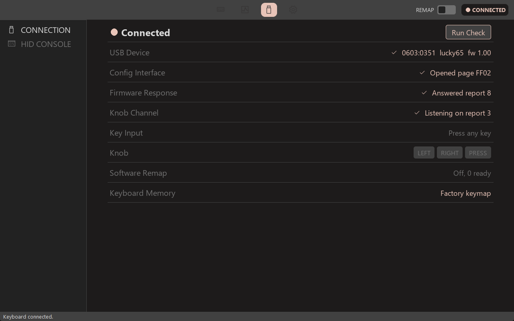
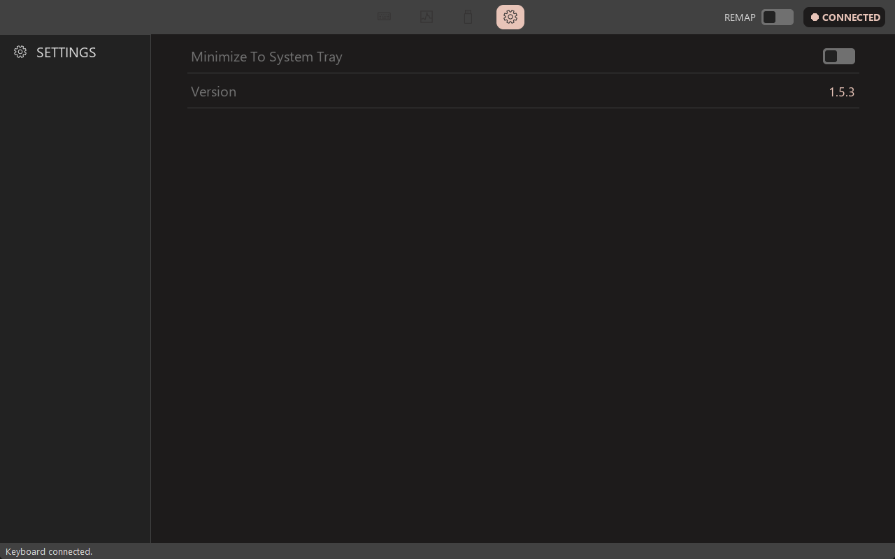

# SK65 Studio user manual

SK65 Studio lets you change what the keys, knob and lights do on a Womier SK65 V1.

**Contents**

- [Install, update and remove](#install-update-and-remove)
- [The main window](#the-main-window)
- [Change a key](#change-a-key)
- [Save to the keyboard](#save-to-the-keyboard)
- [Layers](#layers)
- [The knob](#the-knob)
- [Macros](#macros)
- [Lighting](#lighting)
- [Backups and resetting](#backups-and-resetting)
- [Test the keyboard](#test-the-keyboard)
- [Check the connection](#check-the-connection)
- [Settings and the system tray](#settings-and-the-system-tray)
- [Keyboard shortcuts](#keyboard-shortcuts)
- [Troubleshooting](#troubleshooting)

## Install, update and remove

**Install**

1. Download `Womier_SK65_Studio_Setup.exe` from the [latest release](../../../releases/latest).
2. Run it. If Windows shows a SmartScreen warning, choose **More info**, then **Run anyway**. The installer isn't code signed, so this warning is expected.
3. Approve the administrator prompt and click through the installer.

You only install once. After that, open **Womier SK65 Studio** from the Start menu, by searching for it, or from the desktop shortcut.

**Update**

1. Close the app fully. If it's in the system tray, right-click the tray icon and choose **Exit**.
2. Run the newer `Womier_SK65_Studio_Setup.exe`.
3. Check the version on the app's Settings page.

Your settings are kept. Close the app first, because an update run while it's open may not apply.

**Remove**

Use **Settings > Apps > Installed apps** in Windows, or Programs and Features in Control Panel. Your settings stay in `%APPDATA%\SK65 Studio`. Anything saved into the keyboard stays there too, so restore the factory keymap first if you want it gone.

## The main window

| Area | What it does |
|---|---|
| Top icons | Switch between **Configure**, **Key Tester**, **Device** and **Settings** |
| **REMAP** switch | Turns software remapping on or off. See [Save to the keyboard](#save-to-the-keyboard) |
| **CONNECTED** badge | Shows whether the keyboard is found. Click it to open the connection check |
| **LAYER 0 1 2** | Chooses which layer you're editing |
| Keyboard picture | Click a key or the knob to edit it |
| Left menu | **KEYMAP**, **MACROS**, **LIGHTING** and **SAVE + LOAD** |
| Bottom line | Shows messages, and explains whatever your mouse is over |

## Change a key

1. In **KEYMAP**, click a key on the keyboard picture.
2. Choose a group: **BASIC**, **MEDIA**, **SPECIAL** or **MACRO**.
3. Click what the key should do. The next key is selected for you, so you can keep going.
4. [Save to the keyboard](#save-to-the-keyboard).

The picture shows each key's new action.

| Keycode | Meaning |
|---|---|
| Blank | The key does nothing |
| **▽** | Back to the key's original action |

## Save to the keyboard

There are two ways to apply your changes.

| | Save Into Keyboard Memory | REMAP switch |
|---|---|---|
| Where it runs | In the keyboard | In the app |
| Works with the app closed | Yes | No |
| Works on other computers | Yes | No |
| Layers | All three | Layer 0 only |
| Works in Run as administrator apps | Yes | No |
| Macros | Yes | No |
| Mute, Calculator, Search, mouse wheel | No | Yes, on layer 0 and the knob |

**For keys, saving to the keyboard is usually best.**

1. Open **SAVE + LOAD**.
2. Click **Save** next to **Save Into Keyboard Memory**.
3. Click **Confirm**.
4. Press a changed key to check it.

Before you save, keep in mind:

- A save replaces the whole keymap on all three layers, including anything set earlier in Womier's software.
- If something can't be stored, the app tells you which key it is and saves nothing.
- **Keyboard Memory** shows what the app last saved, or "unsaved changes". The keyboard can't report what it holds, so changes made in other software won't show here.
- Once a keymap is saved on layer 0, the REMAP switch stops changing keys. It still controls the knob.

## Layers

Layers are separate sets of keys, like the Shift key gives letters a second meaning.

| Layer | Active when |
|---|---|
| **0** | Normally |
| **1** | You hold Fn |
| **2** | You hold a key you've set to Fn2 |

Click **0**, **1** or **2** at the top left to choose what you're editing.

On layer 1, keys you leave alone keep the keyboard's built-in Fn functions, such as Fn+F-row and lighting shortcuts.

Layer 2 can't be reached until a key does it. To set one up:

1. On layer 0, click the key you want to use.
2. Open **SPECIAL** and click **Fn2**.
3. Edit layer 2, then save.

The Fn key itself can't be changed here.

## The knob

The knob normally controls volume, and pressing it mutes. Its actions run in the app, not the keyboard.

1. Turn on **REMAP** at the top right.
2. On layer 0, click the knob on the keyboard picture.
3. Click **Rotate Counterclockwise**, **Rotate Clockwise** or **Press Encoder**.
4. Choose an action below. **SPECIAL** has mouse wheel actions.

Keep these in mind:

- The app must stay open, but it can sit in the system tray.
- Closing the app, or turning REMAP off, puts the knob back to volume.
- While an app running as administrator is in focus, the knob goes back to volume.
- To undo a setting, click its row, then click **▽** under **BASIC**.
- The knob can't run macros or Fn2.
- Other devices keep their own volume controls, such as a headset wheel.

The knob has no lights of its own.

## Macros

A macro plays back a recorded series of key presses. You can store 10, numbered M0 to M9.

**Record a macro**

1. Open **MACROS** and choose a slot. Recording replaces what's in that slot.
2. Click **Record**.
3. Type your keys with the app in front. They don't act on Windows while recording, so shortcuts are safe to record.
4. Click **Stop**.

Each key is stored as two steps, one for pressing it and one for releasing it. So "hi" shows `H down`, `H up`, `I down`, `I up`. That's normal, and it plays each letter once. Small numbers show the wait in milliseconds.

**Choose how it plays**

| Setting | What it does |
|---|---|
| **Once**, or a number | Plays that many times from one press, even a quick tap |
| **While Held** | Repeats until you let go, and stops the moment you do, even partway through |
| **As Recorded** | Keeps your typing speed |
| **Fixed 20 ms** | Plays as fast as the keyboard allows |

Macros play about 25% slower than the numbers shown.

**Put it on a key**

1. Open **KEYMAP** and click a key. Any layer works.
2. Click **MACRO**, then the macro.
3. [Save to the keyboard](#save-to-the-keyboard).

A macro key does nothing until it's saved. If you change a macro later, save again.

**Limits**

- 80 steps per macro, which is about 40 key presses.
- No media keys or mouse clicks inside a macro.
- Steps can't be edited one at a time. Record again to change a macro.

## Lighting

Changes reach the keyboard as soon as you make them.

| Setting | What it does |
|---|---|
| **Effect** | The animation. **Off** turns the lights off |
| **Brightness** | Has 5 levels, so small slider moves may not change anything |
| **Speed** | Further right is faster |
| **Color** | One colour, or the rainbow circle for multicolour |
| **Send Again** | Sends the current lighting again |

**Static** can't be multicolour, so it switches to red if multicolour was selected.

If the keys stay dark, press **Fn+Space**. It switches RGB off inside the keyboard, and the app can't turn it back on.

## Backups and resetting

These are all in **SAVE + LOAD**. Scroll down to see them all.

| Option | What it does |
|---|---|
| **Save Current Layout** | Saves your keys, macros, knob and lighting to a file |
| **Load Saved Layout** | Loads that file into the app. Then save to the keyboard |
| **Restore Factory Keymap** | Removes your saved keys from the keyboard. Lighting isn't changed, and your edits stay in the app |
| **Reset Remaps And Knob** | Clears key and knob changes in the app. It doesn't change the keyboard until you save |

## Test the keyboard

Click the second icon at the top for **Key Tester**.

- Keys light up on the picture as you press them. Pink means held, and darker means tested.
- **Keys Tested** counts your progress.
- Scroll down to the **Knob** row, then turn the knob both ways and press it. **LEFT**, **RIGHT** and **PRESS** turn pink.
- **Reset Keyboard** only clears this test. It doesn't change your keyboard.

The tester shows what the keyboard sends. A key changed to `End` lights up the key for `End`, or nothing if the board has no such key.

## Check the connection

Click the third icon at the top, or the **CONNECTED** badge.

A tick means that check passed. Click **Run Check** to test again. Press a key and turn the knob to fill in **Key Input** and **Knob**. This check only reads from the keyboard.

**HID CONSOLE** is for developers. It sends raw data to the keyboard, and the wrong data can change or reset its settings, so leave it alone unless you know what you're sending.

## Settings and the system tray

Click the gear icon at the top.

- **Minimize To System Tray:** when on, the minimize button hides the app in the tray. Click the tray icon to bring it back, or right-click it and choose **Exit**.
- **Version:** the version you're running.

The X button always closes the app fully, so use minimize if the knob needs to keep working.

Only one copy runs at a time. Opening the app again brings back the running copy, even from the tray.

## Keyboard shortcuts

These are built into the keyboard and work without the app. The list comes from a Lucky65 guide, because the SK65 V1 shares its board. Only Fn+Space has been confirmed on an SK65, and some may differ on yours.

| Shortcut | What it does |
|---|---|
| Fn+Space | Turn RGB on or off |
| Fn+\ | Change the lighting effect |
| Fn+Up / Fn+Down | Brightness |
| Fn+Left / Fn+Right | Lighting speed |
| Fn+Tab | Wired mode |
| Fn+Q / W / E, short press | Switch to Bluetooth device 1 / 2 / 3 |
| Fn+Q / W / E, long press | Pair Bluetooth device 1 / 2 / 3 |
| Fn+R | Short press switches to 2.4 GHz, long press pairs |
| Fn+A / Fn+S | Windows mode / Mac mode |
| Fn+Win | Lock or unlock the Windows key |
| Hold Fn+Esc for 3 seconds | Factory reset the keyboard |

## Troubleshooting

| Problem | What to try |
|---|---|
| **NOT CONNECTED** | Connect the USB cable and switch the keyboard to wired mode with Fn+Tab. Then check it's an SK65 V1 |
| Can't find the app | Search the Start menu for "Womier". If it's missing, run the installer again |
| Windows blocks the installer | Choose **More info**, then **Run anyway**. Some antivirus tools may flag the app's keyboard hook |
| A key didn't change | Open **SAVE + LOAD**, and check **Keyboard Memory** doesn't say "unsaved changes" |
| Save says it can't store something | Mute, Calculator, Search and mouse wheel can't be saved. Choose another action, or use REMAP on layer 0 |
| Save says to record a macro first | A key uses an empty macro. Record it, or change that key |
| A macro key does nothing | Save again after recording, and check the key is on the layer you're using |
| Lighting doesn't change | Press Fn+Space. If the keyboard is off or not connected, the bottom row says so |
| The knob only changes volume | Turn **REMAP** on, and keep the app open or in the tray |
| Layer 2 says "Unreachable" | Set a key on layer 0 to **Fn2**, then save |
| An update didn't apply | Close the app fully, including the tray, and run the installer again |
| The keyboard acts strangely | Use **Restore Factory Keymap**, or hold Fn+Esc for 3 seconds. Fn+Esc also clears anything else saved in it |

Still stuck? [Open an issue](../../../issues) with what you did, what happened, and your version from the Settings page.

This is an unofficial project, not made or supported by Womier, Weikav or the VIA team.
